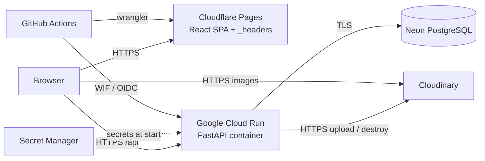
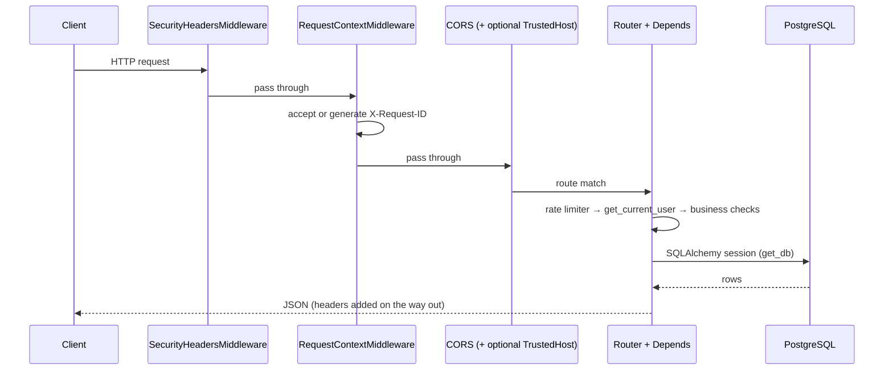
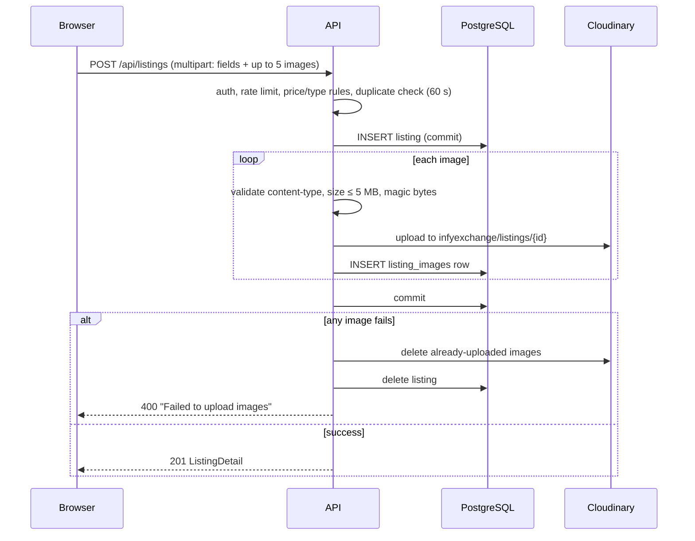

# Architecture

## System overview

InfyExchange is a classic split deployment: a static single-page app, a stateless JSON API, a managed PostgreSQL database, and an image CDN.



| Component | Technology | Responsibility |
| --- | --- | --- |
| Web app | React + Vite on Cloudflare Pages | UI, routing, token storage, form validation, browser security headers |
| API | FastAPI + Uvicorn on Cloud Run | Authentication, authorization, business rules, uploads, rate limiting, migrations |
| Database | Neon PostgreSQL | All persistent records |
| Images | Cloudinary | Stores listing photos; browsers load them directly from `res.cloudinary.com` |
| Secrets | Google Secret Manager | `DATABASE_URL`, `DATABASE_URL_UNPOOLED`, `SECRET_KEY`, 3× Cloudinary credentials |
| CI/CD | GitHub Actions | Test, scan, build, deploy API, then deploy SPA |

There is **no reverse proxy** (no Nginx/Caddy) in production; Cloud Run terminates TLS. The local Docker Compose file starts PostgreSQL only.

## Request lifecycle (API)



Middleware order (outermost first): `SecurityHeadersMiddleware` → `RequestContextMiddleware` → `TrustedHostMiddleware` (only when `ALLOWED_HOSTS` is set) → `CORSMiddleware`. Starlette runs the most recently added middleware first, and `main.py` adds CORS first and the security-headers middleware last.

Three global exception handlers in `main.py` normalise errors:

| Exception | Response |
| --- | --- |
| `RequestValidationError` | `422` with `detail` as a string (one error) or list of `"field: message"` strings |
| `SQLAlchemyError` | `500`, generic message; full error logged server-side |
| any other `Exception` | `500`, generic message; full error logged server-side |

## Backend layering

```text
routers/   HTTP surface: path, params, auth dependency, rate limit, orchestration
  ├─ schemas/    Pydantic request/response models (validation, serialization)
  ├─ models/     SQLAlchemy ORM entities and relationships
  ├─ services/   Cross-cutting logic: passwords+JWT, Cloudinary, rate limiter, cleanup, migrations
  ├─ dependencies.py   get_current_user / get_current_admin
  └─ utils/      enums, logging
```

Routers talk to the database directly through a SQLAlchemy `Session` (`Depends(get_db)`); there is no separate repository layer. Business rules live inline in the router functions. See the [Backend Guide](Backend-Guide.md).

## Frontend layering

```text
main.jsx → App.jsx (ErrorBoundary → AuthProvider → BrowserRouter → Routes)
              ├─ pages/*         screens; each fetches its own data via api.js
              ├─ components/*    Header/Sidebar/AppShell, cards, banners, error boundary
              ├─ context/AuthContext   token (localStorage) + current user
              ├─ services/api.js       fetch wrapper, error parsing, 401 handling, endpoint map
              └─ utils/filters.js      client-side filters for "my listings/needs"
```

There is no global data store or query cache: each page owns its `useState`/`useEffect` loading logic. See the [Frontend Guide](Frontend-Guide.md).

## Cross-origin design

The SPA and the API live on different origins in production (Pages vs `*.run.app` or a custom domain):

- The SPA is built with `VITE_API_BASE_URL=https://<api-host>/api`; `src/services/api.js` prefixes every path with it.
- The API's CORS allow-list (`CORS_ORIGINS`) must contain the **exact** Pages origin. Methods allowed: `GET POST PUT PATCH DELETE OPTIONS`; headers: `Authorization`, `Content-Type`; credentials allowed.
- Authentication is a bearer token in the `Authorization` header, not a cookie, so CORS is purely a browser-side restriction and the API is still callable by anyone holding a valid token.
- API response headers cannot protect the SPA document (it is served from another origin), so `vite.config.js` generates a `_headers` file for Pages containing the SPA's CSP and related headers. See [Security](Security.md#browser-side-controls-spa).

In local development Vite proxies `/api` to `127.0.0.1:8000`, making everything same-origin.

## Data flow: posting a listing with photos



## Background work

`app/services/cleanup.py` deletes expired listings (and their Cloudinary images) and expired needs. It runs:

- as an `asyncio` task started in the FastAPI lifespan – once at startup, then every 24 hours, **inside every API instance**; and
- on demand via `python -m app.run_cleanup`, intended for an external scheduler (for example a Cloud Run Job or Cloud Scheduler).

See [Operations](Operations-and-Troubleshooting.md#expiry-cleanup) for caveats.

## Environments

| Environment | `ENVIRONMENT` | API docs | DB | Notes |
| --- | --- | --- | --- | --- |
| Local dev | `development` | on | Docker Postgres | Migrations failures tolerated |
| Tests | `test` (set by `conftest.py`) | on | temp SQLite file | Lifespan (migrations, cleanup loop) disabled |
| Production (Cloud Run) | `production` | **off** | Neon | Migration failure aborts startup; HSTS enabled |

The `neon-staging` GitHub environment is the only deployment target defined in this repository. `main` and `ship` branches run CI but do **not** deploy from these workflows (see [CI/CD & Deployment](CI-CD-and-Deployment.md)).
