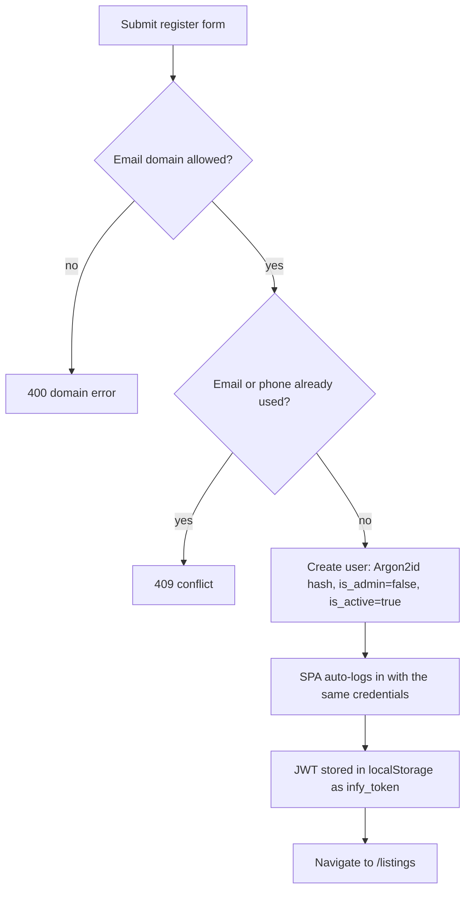
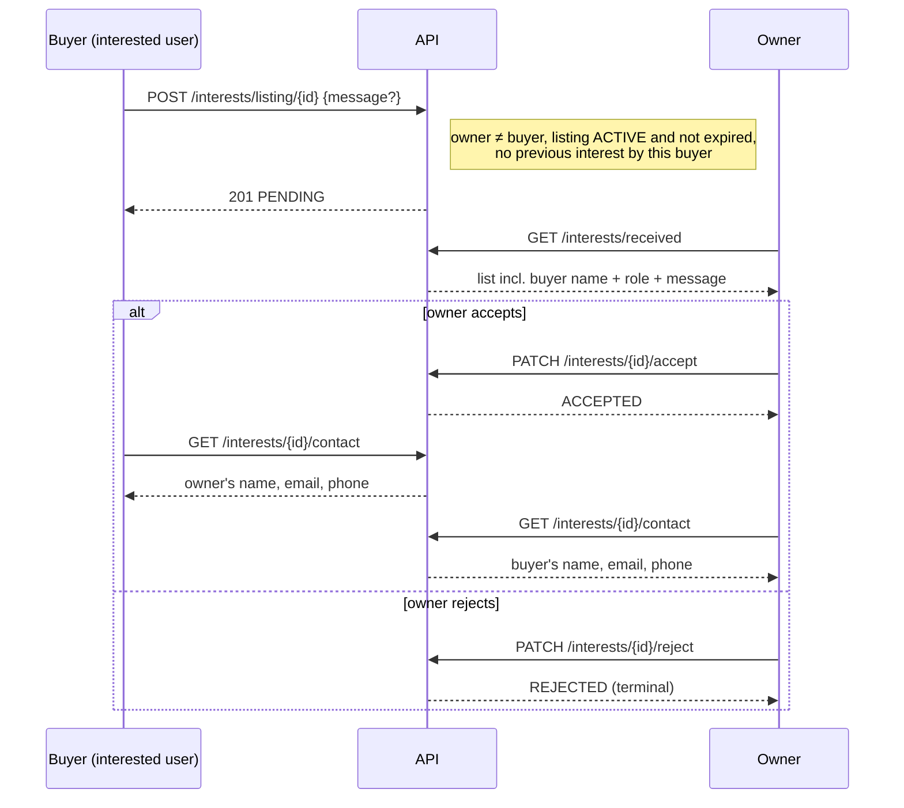

# Business Rules & Flows

This page explains how the marketplace behaves from a user's point of view and where each rule is enforced.

## Actors

| Actor | How they get there | Can do |
| --- | --- | --- |
| Visitor | no account | Browse listings and needs, view details |
| Member | registers with an allowed email domain | Everything a visitor can, plus post listings/needs, express interest, accept/reject requests on their listings, reveal contact after acceptance, delete own listings/needs |
| Admin | `is_admin = true` (set in the DB for the first one, then by another admin) | Everything a member can, plus the admin console: user activation/admin rights, listing status/removal, need removal, audit log |
| Deactivated member | an admin sets `is_active = false` | Nothing – every protected API call returns `403` |

## Registration and sign-in

- The allowed-domain list is a **configuration switch** (`ALLOWED_EMAIL_DOMAINS`), defaulting to Gmail. Despite the community being Infosys-specific, the default does not restrict to a corporate domain.
- **Sign in with Google** (optional, when `GOOGLE_CLIENT_ID` is set) creates an account on first use with only a name and an email. The user is sent to `/complete-profile` for phone, role and joining date; until that is saved they can browse but cannot post items or requests or send enquiries. Later they can change role and joining date from the profile page. Name, email and phone cannot be changed.
- There is no email verification, password reset, password change or account deletion. (The README lists these as unsupported.)
- Login failures are indistinguishable between "unknown email" and "wrong password" and are rate limited per IP and per account.

## Listing types

| Type | Price rules | Meaning |
| --- | --- | --- |
| `SELL` | `price > 0` required | Item for sale |
| `RENT` | `price > 0` required; `price_unit` defaults to `day` (UI offers `day`/`week`/`month`/`hour`) | Item for rent |
| `LEND` | forced to `0`, unit cleared | Free to borrow |
| `GIVEAWAY` | forced to `0`, unit cleared | Free to take |

Needs use `BUY`, `RENT` or `BORROW`, with a free-text `duration`, an optional `budget`, and a location.

## Listing lifecycle

1. **Create** – validated, duplicate-guarded (60 s), saved as `ACTIVE` with `expires_at = created_at + 30 days`; images uploaded to Cloudinary.
2. **Visible** – appears in `GET /listings` only while `status == ACTIVE` **and** `expires_at > now`.
3. **Change status** – the owner can `PUT` a new status (`SOLD`, `RENTED`, `UNAVAILABLE`, back to `ACTIVE`) and admins can set it through the admin API. Non-`ACTIVE` listings disappear from search but remain retrievable by ID. The bundled SPA only offers *delete* to owners; status changes happen via the API or the admin console.
4. **Expire** – after `expires_at`, the listing drops out of search and `GET /listings/{id}` returns `404 Listing has expired` (for `ACTIVE` ones). The cleanup job later deletes the row and its Cloudinary images.
5. **Delete** – owner (API + "My Listings" page) or admin. Interests are cascaded away.

There is no "renew/extend" operation: to keep an item listed beyond 30 days the owner must post it again.

Needs follow the same pattern (30-day expiry, search shows only `ACTIVE`), but owners can neither edit nor delete them from the UI, and the `FULFILLED`/`CLOSED` statuses have no setter in the API.

## Interest → accept → contact flow

Rules and consequences:

- **Contact privacy:** emails and phone numbers are never part of listing or interest payloads. The only route that returns them is `/interests/{id}/contact`, which requires `ACCEPTED` status and that the caller is the listing owner or the interested user. Strangers get `403`. The endpoint has its own rate limiter (20/min/IP).
- **One interest per user per listing**, enforced both in code (`409`) and by a unique constraint.
- **Accepting does not touch the listing.** It stays `ACTIVE`, other pending interests stay pending, and the owner can accept several. Marking an item sold/rented is a separate action.
- **Only pending interests can be accepted or rejected**; accepted/rejected are final.
- A buyer's request is visible to them under "sent" with the listing title and first image; owners see it under "received".

## Activity dashboard

`GET /users/me/summary` powers the profile cards: listings I posted, needs I posted, interests I sent, requests I received, and how many of those are still pending. The sidebar (`AppShell`) links to My profile, My items, My requests, Enquiries (and Admin for admins); the same links are in the account menu so they are reachable on phones.

## Moderation and audit

Admins can:

| Action | Endpoint | Audit `action` |
| --- | --- | --- |
| Deactivate/reactivate a user | `PATCH /admin/users/{id}` `{is_active}` | `UPDATE_USER` |
| Promote/demote an admin | `PATCH /admin/users/{id}` `{is_admin}` | `UPDATE_USER` |
| Change a listing's status | `PATCH /admin/listings/{id}/status?status=…` | `UPDATE_LISTING_STATUS` |
| Delete a listing | `DELETE /admin/listings/{id}` | `DELETE_LISTING` |
| Delete a need | `DELETE /admin/needs/{id}` | `DELETE_NEED` |

Safeguards: an admin cannot remove their own admin flag; no-op user updates are not logged; each log row stores actor, IP, target and a JSON details blob (e.g. before/after values, the listing title, the user's email). Deactivating a user takes effect on their next request because `get_current_user` reads `is_active` from the database every time.

Deactivation does **not** hide the user's existing listings from search; remove or change the status of those separately.

## Duplicate-submission protection

Both listing and need creation look for an identical record from the same user in the last `DUPLICATE_SUBMISSION_WINDOW_SECONDS` (60) and, if found, return it instead of inserting again. This guards against double-clicks and retries. The frontend adds its own guard (`submitLock` ref + disabled button + `AbortController`).

## Limits at a glance

| Item | Limit | Source |
| --- | --- | --- |
| Images per listing | 5 | `MAX_IMAGES_PER_LISTING` |
| Image size | 5 MB each | `MAX_IMAGE_SIZE_MB` |
| Image formats | JPEG, PNG, WebP (content type **and** magic bytes) | `cloudinary.py` |
| Listing/need lifetime | 30 days | `LISTING_EXPIRY_DAYS` |
| Title | 2–150 chars | schemas/forms |
| Location | 2–100 chars | schemas/forms |
| Description | 2–2000 chars | schemas/forms |
| Interest message | ≤ 500 chars | `InterestCreate` |
| Token lifetime | 7 days | `ACCESS_TOKEN_EXPIRE_MINUTES=10080` |
| Public page size | default 20, max 100 | routers |
