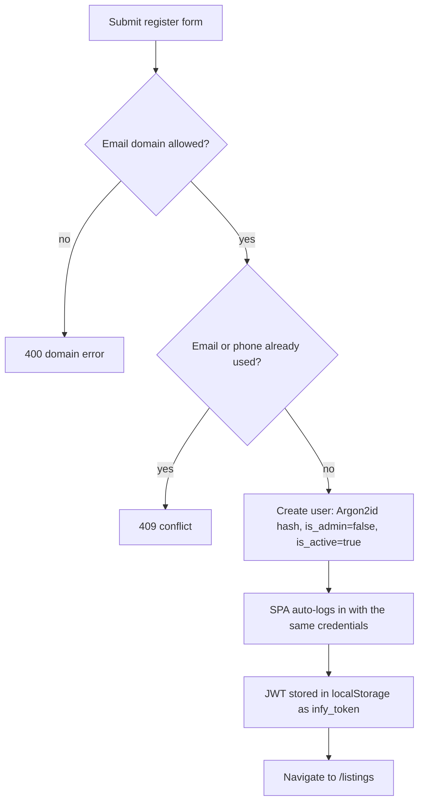

# Business Rules & Flows

This page explains how the marketplace behaves from a user's point of view and where each rule is enforced.

## Actors

| Actor | How they get there | Can do |
| --- | --- | --- |
| Visitor | no account | Browse listings and needs, view details |
| Member | registers with an allowed email domain | Everything a visitor can, plus post listings/needs, send enquiries, accept or decline enquiries on their items and chat with the people they accept, close deals, change the price of or delete their own items, report or block someone in a chat, and see their notification bell |
| Admin | `is_admin = true` (set in the DB for the first one, then by another admin) | Everything a member can, plus the admin console: user activation/admin rights, listing status/removal, need removal, audit log |
| Deactivated member | an admin sets `is_active = false` | Nothing – every protected API call returns `403` |

## Registration and sign-in



- The allowed-domain list is a **configuration switch** (`ALLOWED_EMAIL_DOMAINS`), defaulting to Gmail. Despite the community being Infosys-specific, the default does not restrict to a corporate domain.
- **Sign in with Google** (optional, when `GOOGLE_CLIENT_ID` is set) creates an account on first use with only a name and an email. The user is sent to `/complete-profile` for phone, role and joining date; until that is saved they can browse but cannot post items or requests or send enquiries. Later they can change role and joining date from the profile page. Name, email and phone cannot be changed.
- **Phone numbers** are Indian mobiles only. Spaces, hyphens and a leading `+91` are stripped, and what is left must match `^[6-9][0-9]{9}$` (ASCII digits). The bare 10 digits are stored. The SPA and the API apply the same rule; the API is authoritative. Numbers already stored from before this rule are not re-checked.
- A successful registration queues a **welcome email** to the new address (Google sign-up does not).
- There is no email verification, password reset, password change or account deletion. (The README lists these as unsupported.)
- Login failures are indistinguishable between "unknown email" and "wrong password" and are rate limited per IP and per account.

## Listing types

| Type | Price rules | Meaning |
| --- | --- | --- |
| `SELL` | `price > 0` required | Item for sale |
| `RENT` | `price > 0` required; `price_unit` defaults to `day` (UI offers `day`/`week`/`month`/`hour`) | Item for rent |
| `LEND` | forced to `0`, unit cleared | Free to borrow |
| `GIVEAWAY` | forced to `0`, unit cleared | Free to take |

Needs use `BUY`, `RENT` or `BORROW`, with a free-text `duration`, an optional `budget`, and a location.

## Listing lifecycle

1. **Create** – validated, duplicate-guarded (60 s), saved as `ACTIVE` with `expires_at = created_at + 30 days`; images uploaded to Cloudinary.
2. **Visible** – appears in `GET /listings` only while `status == ACTIVE` **and** `expires_at > now`.
3. **Change status** – an owner no longer sets the status by hand. Closing a deal makes the item **Sold** (sell, giveaway) or **Lent out** (rent, lend); **Mark returned** makes a lent-out item **Available** again. Admins can still set any status through the admin API. Non-`ACTIVE` listings disappear from search but remain retrievable by ID.
3a. **Edit** – the **price is the only thing an owner can change**, and only on an Available sell or rent item. Everything else is locked so people who already enquired are not misled. People chatting with the owner get an in-app notice of the new price.
4. **Expire** – after `expires_at`, the listing drops out of search and `GET /listings/{id}` returns `404 Listing has expired` (for `ACTIVE` ones). The cleanup job later deletes the row and its Cloudinary images.
5. **Delete** – owner (API + "My items" page) or admin. Enquiries and their chat messages are removed with it. When the *owner* deletes, everyone with a pending or chatting enquiry, or who is borrowing it, is first told in the app that it was removed. An admin delete and the expiry cleanup send no such notice.

There is no "renew/extend" operation: to keep an item listed beyond 30 days the owner must post it again.

Needs follow the same pattern (30-day expiry, search shows only `ACTIVE`), but owners can neither edit nor delete them from the UI, and the `FULFILLED`/`CLOSED` statuses have no setter in the API.

## Enquiry → chat → deal flow

Statuses people see: an item is **Available** or **Sold** (**Lent out** for rent/lend); an enquiry is **Pending**, **Chatting**, **Declined** or **Closed** (stored as `PENDING`, `ACCEPTED`, `REJECTED`, `CLOSED`).

```mermaid
sequenceDiagram
    participant B as Buyer
    participant API
    participant O as Owner

    B->>API: POST /interests/listing/{id} {message?}
    API-->>O: bell notification + admin alert email
    alt owner declines (one tap)
        O->>API: PATCH /interests/{id}/reject {reply?}
        API-->>B: bell notification (with the reply)
    else owner accepts
        O->>API: PATCH /interests/{id}/accept
        API-->>B: bell notification
        Note over B,O: Chat opens; phone/email can be revealed to both
        B->>API: POST /interests/{id}/messages
        O->>API: POST /interests/{id}/close-deal
        Note right of API: Item Sold / Lent out; every other open enquiry Closed and told it is gone
        B->>API: POST /interests/{id}/received {received} (optional)
        O->>API: POST /listings/{id}/mark-returned (rent/lend only)
    end
```

- **Accept opens a chat and keeps the item Available.** The owner can accept several enquiries at once and chat with all of them.
- **Decline is one tap**, with an optional one-line quick reply that is shown to the buyer.
- **Close deal** sits in every chat as "Close deal with [name]" (worded Sold / Rented to / Lent to / Given to). Confirming sets the item to Sold or Lent out, closes every other pending or chatting enquiry, and tells those buyers it is no longer available.
- **Mark returned** (rent/lend) puts the item back to Available and ends the borrower's chat.
- **"Did you get it?"** asks the buyer Yes/No after a deal closes. It is optional and blocks nothing; the owner is told the answer.
- **Reminder:** a chat with no activity for 48 hours gets one in-app reminder to the owner (*Close deal* / *Still available*). Any new message or *Still available* re-arms it. A **pending** enquiry nobody answers for 7 days closes and the buyer is told.
- **Contact privacy:** emails and phone numbers are never part of listing, interest, chat or notification payloads. The only route that returns them is `GET /interests/{id}/contact`, for a chatting enquiry and for the deal winner, to the owner or the interested user only. The one deliberate exception is outside the API: the admin alert email for an enquiry contains the enquirer's email so the admin can reply.
- **One enquiry per user per listing**, enforced both in code (`409`) and by a unique constraint. A pending, chatting or declined enquiry stays final (a decline is the owner's explicit no). A **closed** one (the deal went to someone else, it expired after 7 days, or the item was returned) is **reopened** as a fresh pending enquiry when that person enquires again, as long as the item is Available: the same row is reused, its 7-day clock restarts and the owner is notified and the admin alerted again.
- **Chat safety:** either person can report the other (admins read reports under *Admin → Reports*) and block them. A block silences all messages between the two accounts in both directions without saying who blocked whom, and stops the blocked person from sending new enquiries.
- A buyer sees their enquiries under "sent" with the item title, image, status and any decline reply; owners see them under "received". Both show an unread-message badge and an *Open chat* link.

## Notifications and email

The **bell** in the header polls every 30 seconds and shows an unread count; each entry opens the relevant chat. Kinds: new enquiry, accepted, declined, closed-out, expired, deal closed, new message (once per unread run), price changed, item returned, item removed, buyer's answer, quiet-chat reminder.

**Email** is deliberately small: a welcome email at registration and an alert to `ADMIN_EMAIL` for each enquiry. Sellers and buyers are told of everything else through the bell only. A failed send is stored for an admin to retry or discard (*Admin → Failed emails*).

## Activity dashboard

`GET /users/me/summary` powers the profile cards: listings I posted, needs I posted, interests I sent, requests I received, and how many of those are still pending. The sidebar (`AppShell`) links to My profile, My items, My requests, Enquiries (and Admin for admins); the same links are in the account menu so they are reachable on phones.

## Moderation and audit

Admins can:

| Action | Endpoint | Audit `action` |
| --- | --- | --- |
| Deactivate/reactivate a user | `PATCH /admin/users/{id}` `{is_active}` | `UPDATE_USER` |
| Promote/demote an admin | `PATCH /admin/users/{id}` `{is_admin}` | `UPDATE_USER` |
| Change a listing's status | `PATCH /admin/listings/{id}/status?status=…` | `UPDATE_LISTING_STATUS` |
| Delete a listing | `DELETE /admin/listings/{id}` | `DELETE_LISTING` |
| Delete a need | `DELETE /admin/needs/{id}` | `DELETE_NEED` |

Safeguards: an admin cannot remove their own admin flag; no-op user updates are not logged; each log row stores actor, IP, target and a JSON details blob (e.g. before/after values, the listing title, the user's email). Deactivating a user takes effect on their next request because `get_current_user` reads `is_active` from the database every time.

Deactivation does **not** hide the user's existing listings from search; remove or change the status of those separately.

## Duplicate-submission protection

Both listing and need creation look for an identical record from the same user in the last `DUPLICATE_SUBMISSION_WINDOW_SECONDS` (60) and, if found, return it instead of inserting again. This guards against double-clicks and retries. The frontend adds its own guard (`submitLock` ref + disabled button + `AbortController`).

## Limits at a glance

| Item | Limit | Source |
| --- | --- | --- |
| Images per listing | 5 | `MAX_IMAGES_PER_LISTING` |
| Image size | 5 MB each | `MAX_IMAGE_SIZE_MB` |
| Image formats | JPEG, PNG, WebP (content type **and** magic bytes) | `cloudinary.py` |
| Listing/need lifetime | 30 days | `LISTING_EXPIRY_DAYS` |
| Title | 2–150 chars | schemas/forms |
| Location | 2–100 chars | schemas/forms |
| Description | 2–2000 chars | schemas/forms |
| Interest message | ≤ 500 chars | `InterestCreate` |
| Decline reply | ≤ 200 chars | `InterestDecline` |
| Chat message | 1–1000 chars | `MessageCreate` |
| Report reason | 5–500 chars | `ReportCreate` |
| Price after posting | 1 – 10 000 000 | `ListingUpdate` |
| Unanswered pending enquiry | closes after 7 days | `PENDING_ENQUIRY_EXPIRY_DAYS` |
| Quiet chat | one reminder after 48 hours | `CHAT_INACTIVITY_REMINDER_HOURS` |
| Token lifetime | 7 days | `ACCESS_TOKEN_EXPIRE_MINUTES=10080` |
| Public page size | default 20, max 100 | routers |
