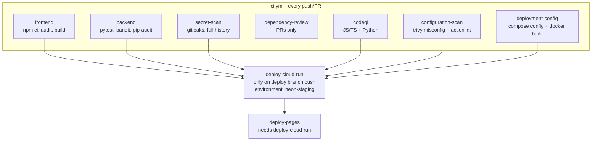

# CI/CD & Deployment

> **Status:** deployed successfully – Cloudflare Pages (<https://infyexchange.pages.dev/>) → Cloud Run → Neon. See the [live snapshot](Operations-and-Troubleshooting.md#live-deployment-snapshot). **Pushing to the deploy branch updates production.**

All automation is in `.github/workflows/`:

| File | Trigger | Purpose |
| --- | --- | --- |
| `ci.yml` | push to `main`, `ship`, `deploy/neon-cloudrun-cloudflare-pages`; every pull request | Quality and security gates; on the deploy branch it also calls the two deploy workflows |
| `cloud-run-deploy.yml` | `workflow_call` from `ci.yml` | Build, scan and deploy the API to Cloud Run |
| `pages-deploy.yml` | `workflow_call` from `ci.yml` | Build the SPA and deploy to Cloudflare Pages |

Dependabot (`.github/dependabot.yml`) opens grouped weekly update PRs for GitHub Actions, npm (`/`), pip (`/backend`) and Docker (`/backend`).

## Pipeline shape



The deploy jobs run only for a **push** to `refs/heads/deploy/neon-cloudrun-cloudflare-pages` and require `frontend`, `backend`, `deployment-config`, `secret-scan`, `codeql` and `configuration-scan` to pass. (`dependency-review` runs only on pull requests and is not a deploy prerequisite.) Pages deploys only if Cloud Run succeeds.

## CI jobs in detail

| Job | What it runs |
| --- | --- |
| `frontend` | Node 22, `npm ci`, `npm audit --audit-level=high`, `npm run build` |
| `backend` | Python 3.12 in `backend/`: upgrade pip/setuptools/wheel/certifi, `pip install -r requirements-dev.txt`, `python -m pytest -q`, `python -m bandit -r app -q`, `python -m pip_audit -r requirements.txt` |
| `secret-scan` | Downloads Gitleaks 8.30.1, verifies its SHA-256, scans all history with redaction; any finding fails |
| `dependency-review` | `actions/dependency-review-action`, fails on severity high+ |
| `codeql` | Matrix `javascript-typescript`, `python`; query suites `security-extended,security-and-quality`; needs `security-events: write` |
| `configuration-scan` | Trivy filesystem **misconfiguration** scan (HIGH/CRITICAL fail) and `actionlint` over the workflows |
| `deployment-config` | `docker compose config -q` in `backend/` and `docker build` of the API image |

All third-party actions are pinned to full commit SHAs (the version is kept in a trailing comment).

## API deployment (`cloud-run-deploy.yml`)

Runs in the `neon-staging` GitHub environment with `id-token: write`; a concurrency group (`cloud-run-neon-staging`, no cancellation) serialises deploys.

1. **Validate** that all required repository variables are set.
2. **Authenticate** to Google Cloud with Workload Identity Federation (`google-github-actions/auth`), then `setup-gcloud` and `gcloud auth configure-docker <region>-docker.pkg.dev`.
3. **Build and push** with `docker buildx build --platform linux/amd64 --provenance=mode=max --sbom=true`, tagged `<region>-docker.pkg.dev/<project>/<repo>/infyexchange-api:<git sha>`. The digest is read from BuildKit's metadata file and validated as `sha256:<64 hex>`; all later steps use `…/infyexchange-api@<digest>`.
4. **Pull** the exact digest, generate a **CycloneDX SBOM** with Trivy and upload it as an artifact retained 90 days.
5. **Block** on fixable HIGH/CRITICAL vulnerabilities (OS and library) in that image.
6. **Deploy** the same digest:

   ```text
   gcloud run deploy $CLOUD_RUN_SERVICE --image $IMAGE --platform managed
     --allow-unauthenticated --service-account $CLOUD_RUN_RUNTIME_SERVICE_ACCOUNT
     --port 8080 --memory 1Gi --cpu 1 --max 3 --concurrency 40
     --set-env-vars ENVIRONMENT=production,CORS_ORIGINS=…,HSTS_ENABLED=true,DB_POOL_SIZE=3,DB_MAX_OVERFLOW=2
     --set-secrets DATABASE_URL=NEON_DATABASE_URL:latest, …
   ```

7. **Health check:** read the service URL and `curl --fail --retry 5 --retry-delay 5 <url>/health`.

Secrets use `:latest`, so a new secret version takes effect on the next revision start/deploy. The container applies pending migrations at startup under an advisory lock (see [Data Model](Data-Model.md#migrations)); with `ENVIRONMENT=production` a failed migration stops the instance from starting, so Cloud Run will not route traffic to a bad revision.

## SPA deployment (`pages-deploy.yml`)

1. Checkout the exact commit, Node 22, `npm ci`.
2. Validate `CLOUDFLARE_API_TOKEN`, `CLOUDFLARE_ACCOUNT_ID`, `CLOUDFLARE_PAGES_PROJECT`.
3. Build with `VITE_API_BASE_URL` – the workflow rejects anything not matching `^https://[^/]+/api$`.
4. `wrangler pages deploy dist --project-name=<project> --branch=deploy/neon-cloudrun-cloudflare-pages`.

> The `--branch` value controls which Pages deployment environment is used. If the Pages project's *production branch* is not set to this branch, Cloudflare treats the upload as a **preview** deployment (inference from how Pages works – verify in your Pages project settings).

`dist/_headers` (generated) and `dist/_redirects` (copied from `public/`) ship with the bundle.

## One-time setup

Follow the [Security Runbook](../docs/security/SECURITY_RUNBOOK.md) (Google Cloud, Neon, Cloudflare steps) and the [DevSecOps checklist](../docs/security/DEVSECOPS_PIPELINE.md#required-repository-and-cloud-settings) (GitHub protections). Variable and secret names are in the [Configuration Reference](Configuration-Reference.md#github-actions-variables-and-secrets). Two ordering points are easy to miss:

- `VITE_API_BASE_URL` needs the Cloud Run service URL, so deploy the API first (or set the variable after the first API run) and then deploy Pages.
- The Pages project's production branch should match the branch passed to `wrangler`, otherwise uploads become preview deployments.

## Releasing

1. Merge changes to the deploy branch (or push to it). CI runs; reviewers approve the `neon-staging` environment.
2. Cloud Run deploys; the health check must pass.
3. Pages deploys.
4. Smoke test from the Pages origin: register/login, create a listing with an image, send and accept an interest, reveal contact, and (with an admin) open `/admin`. Confirm `/docs` returns 404 on the API and that CORS rejects another origin. Use synthetic accounts and data.

## Rollback

- **API:** Cloud Run keeps previous revisions. Shift traffic back with `gcloud run services update-traffic "$CLOUD_RUN_SERVICE" --to-revisions=<good-revision>=100 --project … --region …`, then revert the source and push so Git matches production.
- **Database:** migrations are not automatically reversed. Before rolling back, confirm the previous revision works with the current schema – this is why changes must be backward-compatible across one release. For data recovery use Neon point-in-time restore/branching and record the measured recovery time.
- **SPA:** redeploy a previous commit or use Cloudflare Pages' rollback to an earlier deployment.

## Branch notes

- `main` and `ship` run CI only. The pipeline doc states `main` uses a separate Oracle/Cloudflare strategy that is not in this repository; these workflows deploy only from `deploy/neon-cloudrun-cloudflare-pages`.
- The repository's git history shows the progression from a Caddy-based deployment to Cloud Run + Pages (`Add Caddy deployment and CI setup` → `Deploy Neon backend on Cloud Run and Pages` → `Run branch deployments from CI` → hardening commits).
