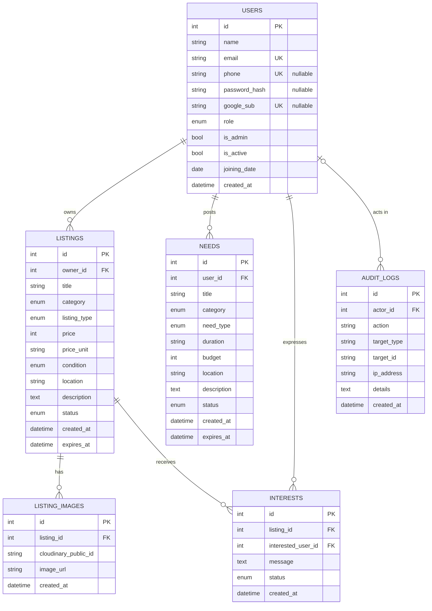
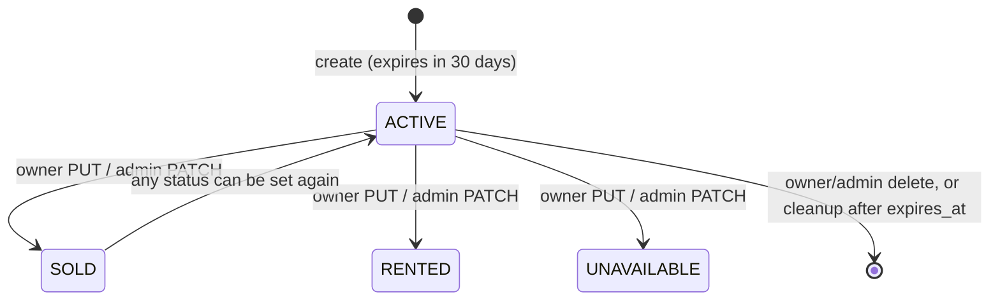

# Data Model

Six tables, all defined with SQLAlchemy 2 declarative models in `backend/app/models/` and created by the single Alembic revision `ee1edd3df3f3` ("initial schema", 2026-10-19).

## Entity-relationship diagram



## Tables

### `users`

| Column | Type | Constraints / notes |
| --- | --- | --- |
| `id` | int | PK |
| `name` | varchar(100) | not null |
| `email` | varchar(255) | unique, indexed; stored lower-case |
| `phone` | varchar(20) | unique, indexed; **nullable** until a Google-created account completes its profile |
| `password_hash` | varchar(255) | Argon2id hash (via `pwdlib`); **nullable** for Google-only accounts |
| `google_sub` | varchar(64) | unique, indexed, nullable; Google's stable account id |
| `role` | enum `userrole` | `SE`, `DSE`, `SP_L1`, `SP_L2`; nullable until the profile is complete |
| `is_admin` | bool | default `false`; no API path sets it initially |
| `is_active` | bool | default `true`; `false` blocks all protected endpoints |
| `joining_date` | date | supplied at registration or in the complete-profile step; nullable until then |
| `created_at` | timestamp | naive UTC, `datetime.utcnow` |

`profile_complete` is a computed property (`phone`, `role` and `joining_date` all set), not a column. Migration `b7c41d9e5a20` relaxed the four NOT NULLs and added `google_sub`; it is backward compatible with the previous revision's code.

Relationships `listings`, `needs`, `interests` all use `cascade="all, delete-orphan"` and the FKs use `ON DELETE CASCADE`, so deleting a user removes everything they own. (The API has no user-deletion endpoint.)

### `listings`

| Column | Type | Notes |
| --- | --- | --- |
| `owner_id` | FK → `users.id` | cascade, indexed |
| `title` | varchar(150) | |
| `category` | enum `listingcategory` | indexed |
| `listing_type` | enum `listingtype` | indexed |
| `price` | int | whole rupees; default 0 |
| `price_unit` | varchar(30), null | e.g. `day`, `week` |
| `condition` | enum `itemcondition` | |
| `location` | varchar(100) | free text, e.g. "ECC" |
| `description` | text | |
| `status` | enum `listingstatus` | default `ACTIVE`, indexed |
| `created_at`, `expires_at` | timestamp | both indexed; expiry = creation + 30 days |

### `listing_images`

`listing_id` (FK cascade, indexed), `cloudinary_public_id` (varchar 255 – needed to delete the asset), `image_url` (varchar 1000, the Cloudinary `secure_url`), `created_at`. "First image" for cards is the row with the lowest `id`.

### `interests`

| Column | Notes |
| --- | --- |
| `listing_id` | FK cascade, indexed |
| `interested_user_id` | FK → `users.id` cascade, indexed |
| `message` | text, optional (API caps at 500 chars) |
| `status` | `PENDING` (default) / `ACCEPTED` / `REJECTED`, indexed |
| `created_at` | |

Unique constraint **`unique_listing_interest (listing_id, interested_user_id)`** – one interest per user per listing.

### `needs`

Mirror of listings for requests: `user_id`, `title`, `category` (shares the `listingcategory` enum), `need_type` (`BUY`/`RENT`/`BORROW`), `duration` (free text), `budget` (int, default 0), `location`, `description`, `status` (`ACTIVE`/`FULFILLED`/`CLOSED`), `created_at`, `expires_at`.

### `audit_logs`

| Column | Notes |
| --- | --- |
| `actor_id` | FK → `users.id`, **`ON DELETE SET NULL`**, indexed – audit rows outlive the admin |
| `action` | varchar(50), indexed: `UPDATE_USER`, `UPDATE_LISTING_STATUS`, `DELETE_LISTING`, `DELETE_NEED` |
| `target_type` | varchar(50), indexed: `USER`, `LISTING`, `NEED` |
| `target_id` | varchar(100), indexed; stringified ID |
| `ip_address` | varchar(45) – fits IPv6 |
| `details` | text; JSON-encoded (old/new values, titles, email) |
| `created_at` | indexed |

The table is append-only by convention; nothing in the code updates or deletes rows.

## PostgreSQL enum types

`userrole`, `listingtype`, `listingcategory` (shared by listings and needs), `itemcondition`, `listingstatus`, `intereststatus`, `needtype`, `needstatus`. The migration's `downgrade()` explicitly drops these types because PostgreSQL does not drop them with the tables.

> Adding a value to a Python enum is **not** enough: the PostgreSQL enum type must be altered in a new migration (`ALTER TYPE ... ADD VALUE`), and autogenerate will not detect it.

## Lifecycle of records



Listings can move between any statuses via `PUT` (owner) or the admin status endpoint – there is no enforced state machine. Interests are stricter: `PENDING → ACCEPTED` or `PENDING → REJECTED`, terminal thereafter.

## Time handling

All timestamps are **naive UTC** values created with `datetime.utcnow()` and stored in `TIMESTAMP WITHOUT TIME ZONE` columns. Expiry comparisons use `datetime.utcnow()` too. Clients should treat returned datetimes as UTC.

## Migrations

- Location: `backend/alembic/versions/`. Configuration: `backend/alembic.ini`, `backend/alembic/env.py`.
- `env.py` takes the URL from `settings.database_url_unpooled or settings.database_url` (never from `alembic.ini`), imports `app.models` so metadata is complete, and uses `compare_type=True`.
- Startup migration (`services/migration.py`) passes a live connection to Alembic via `config.attributes["connection"]` after taking a **PostgreSQL transaction-level advisory lock** (`pg_advisory_xact_lock(74193820416)`). Concurrent Cloud Run instances therefore serialise their `upgrade head`.
- Rollouts must stay backward-compatible with the previous Cloud Run revision (old code runs against the new schema while traffic shifts). Destructive changes need a staged plan; see [CI/CD & Deployment](CI-CD-and-Deployment.md#rollback).

Adding a migration:

```powershell
cd backend
alembic revision --autogenerate -m "add xyz"
# review the generated file – autogenerate misses enum value changes and renames
alembic upgrade head
```
