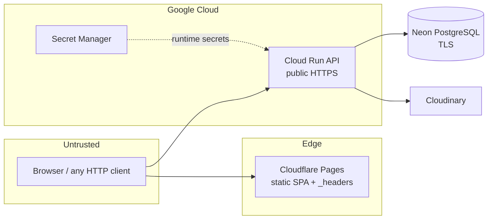

# Security

This page summarises the security design as implemented. This page is the canonical description of how the controls work. The policy, checklist and evidence documents are in [docs/security/](../docs/security/): [Threat model](../docs/security/THREAT_MODEL.md), [Asset inventory](../docs/security/ASSET_INVENTORY.md), [Runbook](../docs/security/SECURITY_RUNBOOK.md) (production setup steps), [DevSecOps pipeline](../docs/security/DEVSECOPS_PIPELINE.md), [Acceptance criteria](../docs/security/ACCEPTANCE_CRITERIA.md) and [Test plan](../docs/security/TEST_PLAN.md).

The repository has no `SECURITY.md` / disclosure policy yet (see [Known Limitations](Known-Limitations-and-Gaps.md)). Never paste secrets, tokens or database URLs into issues, pull requests or logs.

## Trust boundaries

Cloud Run is a **public** API by design (`--allow-unauthenticated`); protection comes from application-level auth, not network ACLs. CORS limits which *browser origins* can use it – it does not authenticate callers.

## Authentication

| Control | Implementation |
| --- | --- |
| Password storage | Argon2id via `pwdlib`, algorithm pinned explicitly (`services/auth.py`) |
| Password policy | 8–100 chars, at least one letter and one digit (`RegisterRequest`) |
| Token | HS256 JWT with `sub` and `exp`; decoder pins `algorithms=[settings.algorithm]` (blocks `alg: none`) |
| Token lifetime | 7 days by default; no refresh, no revocation, no logout endpoint |
| Account state | `is_active` and `is_admin` read from the DB on every request |
| Login errors | Identical for unknown email and wrong password |
| Brute-force controls | 10 attempts/min per IP **and** 10/min per hashed account (key = SHA-256 of the lower-cased email, truncated) |
| Registration abuse | 5/min per IP; email-domain allow-list; unique email and phone |
| Google sign-in | `POST /auth/google` verifies the ID token server-side (`services/google.py`): RS256 only (algorithm pinned), Google's published keys, `aud` = `GOOGLE_CLIENT_ID`, issuer, expiry, `email_verified`. Failures are one generic `401`. Shares the 10/min login limiter. An existing password account with the same email is **never auto-merged** (registration does not prove mailbox ownership, so merging would allow pre-hijacking); the user gets a `409` instead |
| Incomplete profiles | Google-created accounts have no phone, role or joining date until `complete-profile`; posting and enquiring return `403` until then, so no marketplace action happens without contact details on file |

**Key management:** `SECRET_KEY` signs all tokens. Rotating it invalidates every issued token (the only available mass-revocation mechanism). Production should use at least 32 random bytes from Secret Manager.

## Authorization

- Every non-public route declares `Depends(get_current_user)`; admin routes are protected once at router level (`get_current_admin`), so a new admin route cannot forget the check.
- Ownership is verified explicitly in each mutation (`listing.owner_id != current_user.id → 403`).
- **Contact details** are exposed only by `/interests/{id}/contact` to the owner and the interested user of an `ACCEPTED` interest.
- Responses use explicit Pydantic `response_model`s; `password_hash` and `google_sub` are never serialised (covered by tests).
- Profile editing (`PATCH /users/me`) accepts only `role` and `joining_date`; unknown fields (including `is_admin`) are rejected with `422`, not ignored.
- Self-lockout protection: an admin cannot revoke their own admin rights.

## Input validation

- Pydantic constraints on all bodies; `Form(...)` constraints on the multipart listing endpoint; `Query(ge=, le=)` on pagination and prices; enums for every categorical field.
- SQL: SQLAlchemy ORM with bound parameters throughout (tests include quote/SQL-metacharacter search inputs). `ILIKE` searches use bound patterns.
- Uploads: content-type allow-list, streaming size cap, magic-byte verification, Cloudinary-side storage under a per-listing folder. **No malware scanning.**
- Error messages never include stack traces, SQL or internal paths; unhandled errors are logged server-side with the request ID.

## Response security headers (API)

Applied by `SecurityHeadersMiddleware` on every response (via `setdefault`, so a route can override):

| Header | Value / condition |
| --- | --- |
| `X-Content-Type-Options` | `nosniff` |
| `X-Frame-Options` | `DENY` |
| `Referrer-Policy` | `strict-origin-when-cross-origin` (configurable) |
| `Permissions-Policy` | `camera=(), microphone=(), geolocation=(), payment=()` (configurable) |
| `Content-Security-Policy` | `default-src 'none'; frame-ancestors 'none'; base-uri 'none'; form-action 'none'` – skipped for `/docs`, `/redoc`, `/openapi.json` |
| `Cache-Control: no-store` | for paths starting `/api/auth`, `/api/users/me`, `/api/interests`, `/api/admin` |
| `Strict-Transport-Security` | only if `HSTS_ENABLED=true` (set in the Cloud Run deploy); `max-age` default 15 552 000 s (180 days); `includeSubDomains` optional |
| `X-Request-ID` | accepted from the client if `[A-Za-z0-9_.-]{1,64}`, otherwise a random UUID hex; always returned |

Other API hardening: docs/OpenAPI disabled in production; optional `TrustedHostMiddleware` via `ALLOWED_HOSTS`; CORS with an explicit origin list (never `*`, guarded by a test), restricted methods and headers.

## Browser-side controls (SPA)

The SPA is on a different origin from the API, so API headers do not protect it. `vite.config.js` generates `dist/_headers` with nosniff, frame denial, referrer and permissions policies, immutable caching for hashed assets, `no-cache` for `index.html`, and a CSP (details in [Frontend Guide](Frontend-Guide.md#generated-dist_headers-cloudflare-pages)).

**CSP rollout:** the policy currently ships as `Content-Security-Policy-Report-Only`. To enforce: exercise login, listing creation with image upload, admin, and navigation with the browser console open; confirm there are no violation reports; set `CSP_ENFORCE = true` in `vite.config.js`; redeploy Pages. After HTTPS is confirmed, uncomment/enable HSTS on Pages and ramp it like the API's (runbook §5.3–5.4).

## Rate limiting

See [API Reference](API-Reference.md#rate-limits). In-memory, per process, bounded to 10 000 tracked keys. Chat, polling and deal/report/block actions are limited **per signed-in user** instead of per IP, because many trainees share one campus address. Not shared across Cloud Run instances (max 3) and reset on restart, so the effective global limit is up to `limit × instances`.

## Secrets handling

| Secret | Where it lives | Notes |
| --- | --- | --- |
| `SECRET_KEY`, `DATABASE_URL`, `DATABASE_URL_UNPOOLED`, `CLOUDINARY_*` | Set by hand on the Cloud Run service. The owner reports plain environment variables (not verified here); the deploy workflow does not set or change them. Moving them to Secret Manager references is the intended hardening | Never built into the image or the SPA. As plain variables they are readable by anyone with view access to the Cloud Run service |
| `EMAIL_API_KEY` (Brevo), `SENDER_EMAIL`, `ADMIN_EMAIL` | Set by hand on the Cloud Run service; the deploy workflow leaves them alone | Server-side only. Until set, `EMAIL_PROVIDER` stays `console` and emails are printed to the log |
| `CLOUDFLARE_API_TOKEN` | GitHub Actions secret | Scoped to Pages deploy |
| GCP access from GitHub | Workload Identity Federation (OIDC) | No long-lived service-account key |
| `VITE_API_BASE_URL` | GitHub variable / Pages setting | **Public** by nature (embedded in the bundle) |

`.gitignore` excludes `.env` and `.env.*` except `.env.example`; `backend/.dockerignore` and `.gcloudignore` also exclude them. CI runs Gitleaks over the full Git history.

## Supply chain and pipeline controls

Pinned actions, Dependabot, `npm audit`/`pip-audit`, Bandit, CodeQL, Gitleaks, Trivy (config + image), SBOM/provenance, digest-pinned deploys, and environment protection are catalogued in [DevSecOps pipeline](../docs/security/DEVSECOPS_PIPELINE.md) and walked through job by job in [CI/CD & Deployment](CI-CD-and-Deployment.md). Image-level facts: the container runs as non-root `appuser` on `python:3.12-slim` and installs only `requirements.txt` (runtime); test and scan tools live in `requirements-dev.txt`.

## Logging and detection

- Security events go to the `security` logger with request IDs; passwords, tokens and DB URLs are never logged. Logs are written to stdout and collected by Cloud Logging.
- Admin actions are persisted in `audit_logs` (actor, IP, target, details).
- Alerting and log retention are **not** configured in this repository; they are listed as administrator tasks.

## Threat summary and residual risk

| Threat | Mitigation present | Residual |
| --- | --- | --- |
| Account takeover by guessing | Argon2id, rate limits, uniform errors | No MFA, no lockout after repeated failures beyond rate limits, no password reset |
| Token theft via XSS | React escaping, CSP (report-only), no inline scripts | JWT in `localStorage`; replayable until expiry; no revocation |
| Horizontal/vertical privilege escalation | Ownership + role checks, tests | Needs ongoing test coverage for new routes |
| API abuse / scraping | Per-IP limits, concurrency caps, bounded scale | Limits not distributed; public lists are unauthenticated |
| Malicious uploads | Type + magic-byte + size checks, Cloudinary hosting | No malware scan; image content not moderated |
| Data loss | Neon backups/PITR (plan-dependent) | Retention and restore tests must be set up and recorded |
| Supply-chain compromise | Pinned actions, scans, SBOM, digest deploys | Dependency freshness depends on Dependabot triage |
| Cloud misconfiguration | WIF, split deploy/runtime service accounts | IAM bindings, Cloud Run ingress, environment protection must be verified by an admin |
| Weak detection | Request IDs, security log events, audit table | Dashboards and alerts not defined |

See [Known Limitations & Gaps](Known-Limitations-and-Gaps.md) for code-level issues found while writing this wiki (for example, admin-deleted listings leaving images in Cloudinary).

## Dynamic scanning and API diffing

- `scripts/security/zap-api-scan.ps1` runs OWASP ZAP (`ghcr.io/zaproxy/zaproxy:stable`) in Docker, in `openapi` mode (API scan from `/openapi.json`) or `baseline` mode (passive SPA scan), writing HTML/MD/JSON reports to `zap-reports/` (git-ignored). Exit code 0 = pass, 1 = alerts at threshold. Use a **staging** API with docs enabled and synthetic data; never scan production.
- `scripts/security/openapi_diff.py` compares routes offered by the backend (live `/openapi.json` or, offline, by importing the app) with paths consumed in `src/services/api.js`, listing dead backend routes and broken frontend calls.
